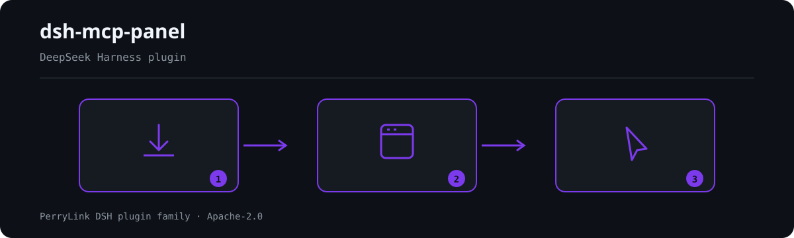

<div align="center">

# dsh-mcp-panel
- **1024 store channel**: `npm i -g dsh1024` once, then `dsh1024 plugin --profile web add dsh-mcp-panel` (counts toward the [deepseek1024.com](https://deepseek1024.com) install ranking).
[](https://gitee.com/perrylink/dsh-mcp-panel)
[](https://dshfind.com/plugins/PerryLink/dsh-mcp-panel?ref=badge)
[](https://api.securityscorecards.dev/projects/github.com/PerryLink/dsh-mcp-panel)

**The MCP management console for the official DeepSeek Harness MCP client — add, edit, remove, and trial-call MCP servers from a settings page, with honest status, health diagnostics, and safe, reversible profile writes.**

*Official client = bridge, this plugin = console: read status through the `mcp/status` seam, write only append-only, approval-gated profile patches.*

> **Official repository.** This is the only official repository of dsh-mcp-panel, maintained by PerryLink. Same-name repositories under other accounts are not affiliated.

[](LICENSE)
[](https://github.com/topics/dsh-plugin)
[](https://github.com/PerryLink/dsh-plugin-doctor#verified-徽章)
[](https://dsh.market/)
[](#)
[](https://github.com/PerryLink/dsh-mcp-panel/actions)
[](https://github.com/PerryLink/dsh-mcp-panel/releases)
[](https://www.npmjs.com/package/dsh-mcp-panel)
[](https://www.npmjs.com/package/dsh-mcp-panel)

[English](README.md) · [简体中文](README-zh.md) · [Español](README-es.md) · [Português](README-pt.md) · [हिन्दी](README-hi.md)

```sh
dsh plugin --profile <name> add dsh-mcp-panel
```


</div>

---

**📖 Ecosystem knowledge base** — measured data, not marketing: [plugin development guide · plugin-selection data · maintenance criteria](https://perrylink.github.io/dsh-plugin-guide/).

<!-- star-cta -->
## Install & uninstall

- **git channel** (latest `main`): `dsh plugin --profile web add github:PerryLink/dsh-mcp-panel` — the `prepare` script builds with production dependencies only.
- **npm channel** (published releases): `dsh plugin --profile web add dsh-mcp-panel`.
- **tarball channel**: `pnpm pack` in this repo, then `dsh plugin --profile web add ./dsh-mcp-panel-<version>.tgz`.
- **uninstall**: remove the `mcp-panel` row from `cordis.patch.yml` (the web surface hot-reloads it), delete the package from the profile's `node_modules`, and verify with `dsh web --dump-config` that no `mcp-panel` row remains.

## ⭐ 如果它帮到了你

这个插件是 [DSH 插件家族](https://github.com/PerryLink)的一员（95 个，全部 Apache-2.0）。如果你在用，**给个 star** —— 它不会解锁任何功能，但会让下一个人在搜索里更容易找到它。

*English:* part of a 95 plugin family for DeepSeek Harness. If it is useful, **a star helps the next person find it** — nothing is gated behind it.


## What is dsh-mcp-panel?

The MCP management console for the official DeepSeek Harness MCP client — add, edit, remove, and trial-call MCP servers from a settings page, with honest status, health diagnostics, and safe, reversible profile writes.

Official client = bridge, this plugin = console: read status through the `mcp/status` seam, write only append-only, approval-gated profile patches.



*Workflow overview: install → open panel → act. The examples below use the real command surface.*


## Compatibility

| Surface | Status |
|---|---|
| Harness | DeepSeek Harness `dsh-v0.2.1-rc.2` (verified 2026-10-18): `engines.dsh >=0.2.1-0 <0.3.0`; the P0 compatibility paths have regression tests. |
| Node | `^22.19.0 \|\| >=24.0.0` |
| Platforms | Web GUI (dual-face: host + browser) |
| Model | Any (the panel is read-only; only `/mcp` output is model-readable) |

## What you get

`dsh-mcp-panel` is the experience layer on top of the official MCP client: a read-only runtime view plus safe, reversible profile writes.

- **`/mcp` command** — one row per server: transport, target, tool count, connection status (from the upstream seam; `unknown` when unobserved), last error, reconnect count — model-readable, session-log reconstructable, five output languages.
- **`/mcp <server> tools`** — model-visible `mcp__*` tool names and descriptions.
- **`/mcp <server> health`** — derived self-heal suggestions (ENOENT → missing dependency, ECONNREFUSED, timeouts, 401/403/404, DNS, rate limit, reconnect exhaustion…); exit code / stderr tail honestly labeled *pending upstream support* until the client exposes them.
- **`/mcp <server> disable` / `enable`** — turn one server row off or back on without editing the profile patch by hand.
- **`/mcp <server> probe`** — one Streamable HTTP connectivity probe for that server (background job).
Trials use one unlogged batch on executor-based Harness releases and the released single-call API on older installations. Both paths retain the active tool permissions and approval policy.

- **`/mcp <server> call <tool> [json]`** — trial-call through the **official tool pipeline** (`ctx.tools.execute()`); pre-execute permission policy, approval, guards, and post-execute all apply.
- **Settings → Plugins → MCP tab** — status cards with badges, diagnostics, and probes, plus the server CRUD and the tool trial console.
- **Server CRUD** — add/edit/remove forms → `insert` for add and id-targeted overrides (`- id:` + `name:` + `disabled:`/`config:`) for edit/remove → clipboard copy or approval-gated write with automatic backups and loader re-verification.
- **Resources browse** — read-only resource listing, template listing, and URI reads through the official `list_mcp_resources` / `list_mcp_resource_templates` / `read_mcp_resource` tools (bridged by the shipped `@deepseek-ai/dsh-mcp-resources` service); results are shown in the tab only, never in model context.
- **Recommended directory** — a built-in community MCP server catalog (filesystem, git, github, fetch, playwright, …) served in the snapshot; `catalogEntries` appends/overrides entries, and `catalogToConfigInput` turns one into a one-click add.
- **Config import/export** — `exportConfigs()` serializes the server rows to a versioned JSON document (a `!!js` row exports as `null` with a reason), and `importPreview()` parses an export back into per-server `add` patch fragments for review.
- **Tool trial console** — server → `mcp__*` tool → JSON args → canonical JSON result + rendered content; capped by `trialMaxResultChars`; panel-only, never model context.

## Architecture: official client = bridge, this plugin = console

[`@deepseek-ai/dsh-mcp-client`](https://github.com/deepseek-ai/deepseek-harness/tree/master/packages/mcp/mcp-client) is the **only bridge**: one plugin instance per MCP server, configured as a hand-written `cordis.yml` row, connecting the transport, syncing tools, and registering `mcp__<server>__<tool>` names. This plugin never replaces it — it is the **experience layer on top**:

```text
                    ┌────────────────────────────────────────────┐
 profile            │  cordis.yml / cordis.patch.yml             │
 composition        │   - id: mcp-github                          │
 (one row per       │     name: '@deepseek-ai/dsh-mcp-client'     │
  server, hand-     │     config: { serverName, transport, … }    │
  written)          │   - id: mcp-panel                           │
                    │     name: dsh-mcp-panel   ◄── this plugin   │
                    └───────────────┬────────────────────────────┘
                                    │
        ┌───────────────────────────┴───────────────────────────┐
        │                                                        │
   ┌────▼──────────────┐        ┌───────────────────────────┐    │
   │ @deepseek-ai/dsh- │        │ dsh-mcp-panel (console)   │    │
   │ mcp-client        │        │                           │    │
   │ • transport       │        │ • /mcp command            │    │
   │ • tool sync       │        │ • Settings → Plugins →    │    │
   │ • mcp__* tools    │◄──────►│   MCP tab: CRUD, trial    │    │
   │ • mcp/status seam │ status │ • health diagnostics      │    │
   └───────────────────┘        │ • probes, capabilities    │    │
                                └───────────────────────────┘    │
```

The console **reads** the client through its proposed `mcp/status` observability seam (not yet shipped upstream; feature-detected) (event + `mcpStatus` query service), the tool registry, and the loader; it **writes** only the profile's patch layer — append-only, approval-gated, always backed up. Transport, OAuth, and protocol stay untouched.

## Console vs. hand-written cordis.yml

| | Hand-written cordis.yml | dsh-mcp-panel console |
|---|---|---|
| Add a server | Edit YAML, mind indent/quoting | Form → patch fragment → **copy** or **write** (approval + auto backup) |
| Edit a server | Edit YAML, restart/hot-reload | Form pre-filled from the live row; unchanged secrets keep their raw values host-side |
| Remove a server | Delete the row | `- id:` + `disabled: true` override (the patch vocabulary has no remove) — re-enableable anytime |
| See status | Read logs | Badges + reconnects + last error, live from the `mcp/status` seam |
| Try a tool | Ask the model to call it | Trial console → official `ctx.tools.execute()` pipeline (permission & approval stay in force) |
| Diagnose failures | Grep logs | `/mcp <server> health` with derived self-heal suggestions |
| Mistakes | Manual revert | Every write is append-only and leaves a timestamped backup |

The console's output IS `cordis.patch.yml` vocabulary — the same lines you would write by hand, generated, previewed, and applied safely.

## Quick start

```sh
dsh plugin --profile web add github:PerryLink/dsh-mcp-panel
```

```sh
# 1. install the bundle into your profile
dsh plugin --profile web add github:PerryLink/dsh-mcp-panel

# or from npm (published releases)
dsh plugin --profile web add dsh-mcp-panel

# 2. restart and verify the row
dsh --profile web --dump-config | grep -A3 'id: mcp-panel'
```

Then open **Settings → Plugins → MCP**, or run:

```text
/mcp
/mcp everything tools
/mcp everything health
/mcp everything call echo '{"message": "hi"}'
```

### Examples

These are the plugin's real entry points; install once, then call one.

#### Detailed example

**Command**

~~~sh
/mcp github tools
~~~

**Output**

~~~text
Tools of "github" (1, model-visible public names):
- mcp__github__create_issue — Create a new issue in a GitHub repository
~~~

*Observed from `plugins/dsh-mcp-panel/tests/command.spec.ts:99-110; renderer at src/command.ts:352-360`*

#### Failure branch

**Input**

~~~text
/mcp nope tools
~~~

**Output**

~~~text
Unknown MCP server "nope" (configured: github)
~~~

*Observed from `plugins/dsh-mcp-panel/src/command.ts:104-105; plugins/dsh-mcp-panel/tests/command.spec.ts:152-157`*

#### Brief examples

- `/mcp <server> tools`
- `/mcp <server> health`

## Configuration

All tunables are Schemastery `Config` fields (changeable from cordis.yml). `cordis.patch.yml` documents the common keys inline; the full key list lives in the table below.

| Key | Default | Meaning |
|---|---|---|
| `probeEnabled` | `true` | Register the `mcp_probe` background-job tool (panel-only results) |
| `probeTimeoutMs` | `10000` | Per-probe timeout in ms |
| `maxProbes` | `10` | Probe records shown in the panel |
| `refreshIntervalMs` | `0` | Suggested panel refresh in ms; `0` = on demand |
| `outputLanguage` | `en` | `/mcp` output language: `en \| zh \| es \| pt \| hi` |
| `passiveProbeEnabled` | `false` | Periodically probe streamable-http servers |
| `passiveProbeIntervalMs` | `60000` | Passive probe interval in ms |
| `trialEnabled` | `true` | Tool trial console (settings tab + `/mcp call`) |
| `trialTimeoutMs` | `120000` | Panel-side deadline per trial call in ms |
| `trialMaxResultChars` | `60000` | Cap on the trial result payload in chars |
| `writeEnabled` | `true` | Kill switch: `false` rejects every profile write (copy still works) |
| `writeVerifyEnabled` | `true` | Re-verify each write against the loader's re-applied state before reporting success |
| `writeVerifyTimeoutMs` | `3000` | Polling budget for write verification in ms |
| `backupCount` | `5` | `cordis.patch.yml` backups retained per write |
| `catalogEntries` | `[]` | User overlay for the recommended server directory: entries append, an entry with the same `id` replaces the built-in one |

Claude requests omit `mcp_probe`; other providers retain it when enabled. Configured MCP tools and manual panel probes remain available. Switching providers takes effect on the next request.

## Tools & surfaces

| Surface | Kind | Notes |
|---|---|---|
| `/mcp` | command | Per-server status row; model-readable and log-reconstructable |
| `/mcp <server> tools` | command | Model-visible `mcp__*` tool names + descriptions |
| `/mcp <server> health` | command | Derived self-heal suggestions from sanitized error text |
| `/mcp <server> disable` / `enable` | command | Toggle one server row in the profile patch |
| `/mcp <server> probe` | command | One Streamable HTTP connectivity probe (background job) |
| `/mcp <server> call <tool> [json]` | command | Trial-call through the official tool pipeline |
| `mcp_probe` | tool | Optional Streamable HTTP connectivity probe (background job) |
| Settings → Plugins → MCP tab | UI slot | Status cards, server CRUD, and the tool trial console |
| `mcpPanel` Typert Remote | service | Read-only snapshot channel (host → client) |

## Resources & Prompts

Resources ARE bridged upstream: the base bundle mounts `@deepseek-ai/dsh-mcp-resources`, the official client registers each connection's resource provider into `ctx.mcpResources`, and that package owns the three shared tools (`list_mcp_resources`, `list_mcp_resource_templates`, `read_mcp_resource`). The console feature-detects the service and the registered tools, and offers a read-only Resources browser (list / templates / URI read) on every server card — each call runs through the OFFICIAL tool pipeline, and results never enter model context.

MCP **prompt templates** and **resource subscriptions** remain deferred upstream; the capabilities board marks Prompts **pending upstream support**.

## Permissions & data

- **Permissions**: the `dshWorkshop` manifest declares `network:outbound` and `native-code:none`.
- **Data**: the panel is read-only; it writes only append-only `cordis.patch.yml` fragments (approval-gated, backup-first). URL query credentials, userinfo passwords, header values, bearer tokens, and JWTs are redacted before rendering; configured `headers` never enter any snapshot, and env/header **values** never leave the host (the editor sees keys only).

## Security boundaries

- **The bridge stays the bridge.** No transport, OAuth, or protocol changes; one mcp-client row per server, exactly as hand-written.
- **No fake status.** Connection fields without upstream observations read `unknown` / `—` with `statusSource: 'derived'`; exit codes and stderr tails are never invented.
- **Writes are append-only, approval-gated, and backed up.** The console never rewrites `cordis.patch.yml`; it appends generated operations, keeps the newest `backupCount` backups, and re-verifies every write against the loader's re-applied state before reporting success (a skipped patch never reads as success).
- **No prompt injection.** The panel registers **no prompt sections**; its only model-facing text is the two tool/command descriptions.

## Known limitations

- **Prompt templates & resource subscriptions** are pending upstream support — the official client bridges tools and resources, but not prompts or subscriptions.
- **Exit codes / stderr tails** are labeled *pending upstream support* until the client exposes them.
- **Read-only panel** — the console never fakes a connection state; unobservable fields read `unknown` / `-1` / `—`.
- **Writes are verified, not guaranteed** — the console re-verifies each write against the loader's re-applied state and fails honestly when the loader did not apply it (e.g. a row inserted by `$DSH_HOME/cordis.patch.yml`, which a profile-layer patch cannot reach).

## Development

```sh
pnpm run typecheck && pnpm run typecheck:ci && pnpm test && pnpm run build && pnpm run verify:self-contained && pnpm run verify:artifacts && pnpm pack
```

`scripts/verify-headless.mjs` boots the real web profile and prints the exact `/mcp` output. Releases: `node scripts/release.mjs <x.y.z>` runs the full gate, commits, and tags `v<x.y.z>` locally (never pushes).

## Topics

`dsh`, `dsh-plugin`, `deepseek-harness`, `deepseek`, `cordis`, `mcp`, `mcp-client`, `observability`, `panel`

## Contributors

- [@PerryLink](https://github.com/PerryLink) — creator and maintainer.
- [@xiaoyuyu6420](https://github.com/xiaoyuyu6420) — diagnosed the missing client devDependencies behind clean-checkout build failures (PR #5).
- [@feiler0](https://github.com/feiler0) — contributed the stdio MCP server probe (one MCP initialize handshake over stdin/stdout) (PR #7, merged as PR #15).

## PerryLink DSH Plugin Family

This project is part of the DeepSeek Harness plugin family from [PerryLink](https://github.com/PerryLink). The roster stays collapsed below so every README keeps a short first screen; expand it to see every row and its status.

<details>
<summary>Expand all plugins</summary>

| Plugin | Status |
|---|---|
| **[dsh-aqua-input-check](https://github.com/PerryLink/dsh-aqua-input-check)** |  |
| **[dsh-archive-check](https://github.com/PerryLink/dsh-archive-check)** |  |
| **[dsh-auto-review](https://github.com/PerryLink/dsh-auto-review)** |  |
| **[dsh-autotier](https://github.com/PerryLink/dsh-autotier)** |  |
| **[dsh-bid-ca-precheck](https://github.com/PerryLink/dsh-bid-ca-precheck)** |  |
| **[dsh-bid-qual-check](https://github.com/PerryLink/dsh-bid-qual-check)** |  |
| **[dsh-cert-mcp](https://github.com/PerryLink/dsh-cert-mcp)** |  |
| **[dsh-checkpoint-rewind](https://github.com/PerryLink/dsh-checkpoint-rewind)** |  |
| **[dsh-click](https://github.com/PerryLink/dsh-click)** |  |
| **[dsh-composer-history](https://github.com/PerryLink/dsh-composer-history)** |  |
| **[dsh-contract-stance](https://github.com/PerryLink/dsh-contract-stance)** |  |
| **[dsh-customs-doc-check](https://github.com/PerryLink/dsh-customs-doc-check)** |  |
| **[dsh-data-quality](https://github.com/PerryLink/dsh-data-quality)** |  |
| **[dsh-demurrage-ledger](https://github.com/PerryLink/dsh-demurrage-ledger)** |  |
| **[dsh-doublecheck](https://github.com/PerryLink/dsh-doublecheck)** |  |
| **[dsh-drill-script-check](https://github.com/PerryLink/dsh-drill-script-check)** |  |
| **[dsh-eia-guide-check](https://github.com/PerryLink/dsh-eia-guide-check)** |  |
| **[dsh-emergency-plan](https://github.com/PerryLink/dsh-emergency-plan)** |  |
| **[dsh-essay-rubric-check](https://github.com/PerryLink/dsh-essay-rubric-check)** |  |
| **[dsh-evidence-check](https://github.com/PerryLink/dsh-evidence-check)** |  |
| **[dsh-export-ctl-check](https://github.com/PerryLink/dsh-export-ctl-check)** |  |
| **[dsh-fast](https://github.com/PerryLink/dsh-fast)** |  |
| **[dsh-fmea-table-check](https://github.com/PerryLink/dsh-fmea-table-check)** |  |
| **[dsh-forecast-penalty](https://github.com/PerryLink/dsh-forecast-penalty)** |  |
| **[dsh-fund-research](https://github.com/PerryLink/dsh-fund-research)** |  |
| **[dsh-github](https://github.com/PerryLink/dsh-github)** |  |
| **[dsh-gongwen-flow-check](https://github.com/PerryLink/dsh-gongwen-flow-check)** |  |
| **[dsh-gongwen-word-check](https://github.com/PerryLink/dsh-gongwen-word-check)** |  |
| **[dsh-guard-plan-qc](https://github.com/PerryLink/dsh-guard-plan-qc)** |  |
| **[dsh-hazchem-check](https://github.com/PerryLink/dsh-hazchem-check)** |  |
| **[dsh-hazplan-check](https://github.com/PerryLink/dsh-hazplan-check)** |  |
| **[dsh-hidden-risk-map](https://github.com/PerryLink/dsh-hidden-risk-map)** |  |
| **[dsh-hs-classify](https://github.com/PerryLink/dsh-hs-classify)** |  |
| **[dsh-icd-rule-check](https://github.com/PerryLink/dsh-icd-rule-check)** |  |
| **[dsh-industry-research](https://github.com/PerryLink/dsh-industry-research)** |  |
| **[dsh-lawcite-adapter](https://github.com/PerryLink/dsh-lawcite-adapter)** |  |
| **[dsh-laya](https://github.com/PerryLink/dsh-laya)** |  |
| **[dsh-lc-doc-check](https://github.com/PerryLink/dsh-lc-doc-check)** |  |
| **[dsh-learning-gap-check](https://github.com/PerryLink/dsh-learning-gap-check)** |  |
| **[dsh-library](https://github.com/PerryLink/dsh-library)** |  |
| **[dsh-local-ai](https://github.com/PerryLink/dsh-local-ai)** |  |
| **[dsh-lsp-actions](https://github.com/PerryLink/dsh-lsp-actions)** |  |
| **[dsh-mask](https://github.com/PerryLink/dsh-mask)** |  |
| **[dsh-mcp-panel](https://github.com/PerryLink/dsh-mcp-panel)** |  |
| **[dsh-medrec-qc](https://github.com/PerryLink/dsh-medrec-qc)** |  |
| **[dsh-memento](https://github.com/PerryLink/dsh-memento)** |  |
| **[dsh-nsfc-form-check](https://github.com/PerryLink/dsh-nsfc-form-check)** |  |
| **[dsh-nurse-record-check](https://github.com/PerryLink/dsh-nurse-record-check)** |  |
| **[dsh-observe](https://github.com/PerryLink/dsh-observe)** |  |
| **[dsh-origin-rvc-check](https://github.com/PerryLink/dsh-origin-rvc-check)** |  |
| **[dsh-ota-review-check](https://github.com/PerryLink/dsh-ota-review-check)** |  |
| **[dsh-output-styles](https://github.com/PerryLink/dsh-output-styles)** |  |
| **[dsh-paper-doc-adapter](https://github.com/PerryLink/dsh-paper-doc-adapter)** |  |
| **[dsh-permission-rules](https://github.com/PerryLink/dsh-permission-rules)** |  |
| **[dsh-permit-report-check](https://github.com/PerryLink/dsh-permit-report-check)** |  |
| **[dsh-pipeline-check](https://github.com/PerryLink/dsh-pipeline-check)** |  |
| **[dsh-pleading-draft](https://github.com/PerryLink/dsh-pleading-draft)** |  |
| **[dsh-plugin-doctor](https://github.com/PerryLink/dsh-plugin-doctor)** |  |
| **[dsh-plugin-guide](https://github.com/PerryLink/dsh-plugin-guide)** |  |
| **[dsh-plugin-kit](https://github.com/PerryLink/dsh-plugin-kit)** |  |
| **[dsh-plugin-upgrade](https://github.com/PerryLink/dsh-plugin-upgrade)** |  |
| **[dsh-policy-brief-draft](https://github.com/PerryLink/dsh-policy-brief-draft)** |  |
| **[dsh-power-loss-split](https://github.com/PerryLink/dsh-power-loss-split)** |  |
| **[dsh-power-ticket-check](https://github.com/PerryLink/dsh-power-ticket-check)** |  |
| **[dsh-ppap-check](https://github.com/PerryLink/dsh-ppap-check)** |  |
| **[dsh-protest-deadline](https://github.com/PerryLink/dsh-protest-deadline)** |  |
| **[dsh-railway-window](https://github.com/PerryLink/dsh-railway-window)** |  |
| **[dsh-repair-order-qc](https://github.com/PerryLink/dsh-repair-order-qc)** |  |
| **[dsh-research-report](https://github.com/PerryLink/dsh-research-report)** |  |
| **[dsh-review-reply-check](https://github.com/PerryLink/dsh-review-reply-check)** |  |
| **[dsh-rulefile-check](https://github.com/PerryLink/dsh-rulefile-check)** |  |
| **[dsh-safety-brief-check](https://github.com/PerryLink/dsh-safety-brief-check)** |  |
| **[dsh-score](https://github.com/PerryLink/dsh-score)** |  |
| **[dsh-session-sync](https://github.com/PerryLink/dsh-session-sync)** |  |
| **[dsh-site-log-check](https://github.com/PerryLink/dsh-site-log-check)** |  |
| **[dsh-skill-pack-security](https://github.com/PerryLink/dsh-skill-pack-security)** |  |
| **[dsh-soe-decision-check](https://github.com/PerryLink/dsh-soe-decision-check)** |  |
| **[dsh-soilwater-check](https://github.com/PerryLink/dsh-soilwater-check)** |  |
| **[dsh-sop-sync-check](https://github.com/PerryLink/dsh-sop-sync-check)** |  |
| **[dsh-spc-gbt-adapter](https://github.com/PerryLink/dsh-spc-gbt-adapter)** |  |
| **[dsh-talk](https://github.com/PerryLink/dsh-talk)** |  |
| **[dsh-tender-extract](https://github.com/PerryLink/dsh-tender-extract)** |  |
| **[dsh-tender-matrix](https://github.com/PerryLink/dsh-tender-matrix)** |  |
| **[dsh-test-drive](https://github.com/PerryLink/dsh-test-drive)** |  |
| **[dsh-ticktick](https://github.com/PerryLink/dsh-ticktick)** |  |
| **[dsh-translate](https://github.com/PerryLink/dsh-translate)** |  |
| **[dsh-warranty-calc](https://github.com/PerryLink/dsh-warranty-calc)** |  |
| **[dsh-budget](https://github.com/PerryLink/dsh-budget)** | 🧊 FROZEN — see the repo README |
| **[dsh-claude-move](https://github.com/PerryLink/dsh-claude-move)** | 🧊 FROZEN — see the repo README |
| **[dsh-defend](https://github.com/PerryLink/dsh-defend)** | 🧊 FROZEN — see the repo README |
| **[dsh-draw](https://github.com/PerryLink/dsh-draw)** | 🧊 FROZEN — see the repo README |
| **[dsh-reach](https://github.com/PerryLink/dsh-reach)** | 🧊 FROZEN — see the repo README |
| **[dsh-background-agents](https://github.com/PerryLink/dsh-background-agents)** | 🚫 RETIRED — see the repo README |
| **[dsh-session-pin](https://github.com/PerryLink/dsh-session-pin)** | 🚫 RETIRED — see the repo README |
| **[dsh-team-rooms](https://github.com/PerryLink/dsh-team-rooms)** | 🚫 RETIRED — see the repo README |

</details>

## License

[Apache License 2.0](LICENSE) © 2026 dsh-mcp-panel contributors
